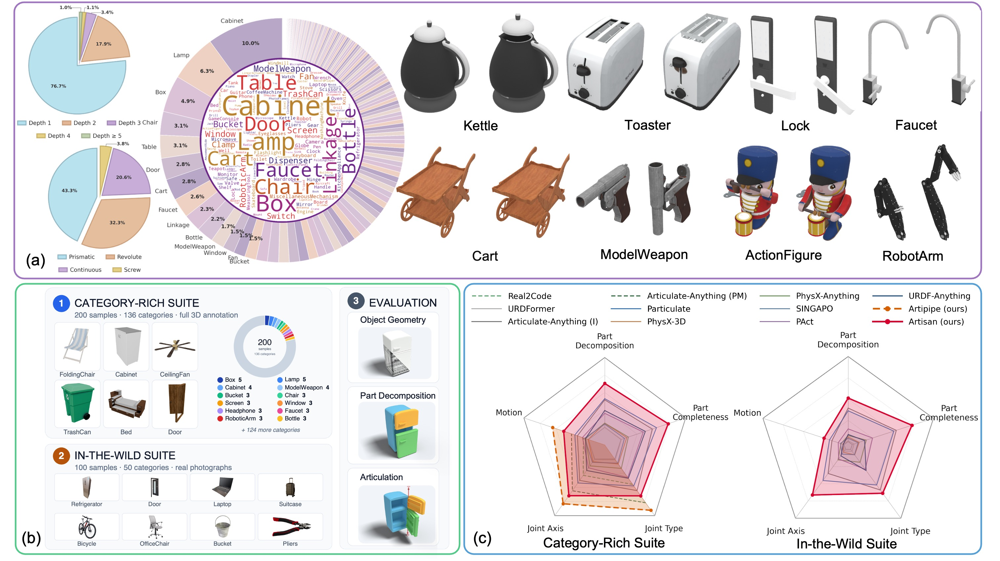

# <p align="center"> <font color=#008000>ArtiAtlas</font>: A Holistic Ecosystem for Diverse 3D Articulation Modeling </p>

<p align="center">
  <a href="https://moonbow721.github.io/">Junzhe Lu</a><sup>1,2</sup>,
  <a href="https://jinglin7.github.io/">Jing Lin</a><sup>2,3†</sup>,
  <a href="https://ziangcao0312.github.io/">Ziang Cao</a><sup>3</sup>,
  <a href="https://www.sigs.tsinghua.edu.cn/whq_en/main.htm">Haoqian Wang</a><sup>1*</sup>,
  <a href="https://liuziwei7.github.io/">Ziwei Liu</a><sup>3</sup>,
  <a href="https://jfzhang95.github.io/">Jianfeng Zhang</a><sup>2*</sup>
  <br>
  <sup>†</sup>Project lead &nbsp;&nbsp; <sup>*</sup>Corresponding authors
  <br>
  <sup>1 </sup>Tsinghua University &nbsp;&nbsp;
  <sup>2 </sup>ByteDance Seed &nbsp;&nbsp;
  <sup>3 </sup>S-Lab, Nanyang Technological University
  <br>
  <b>SIGGRAPH Asia 2026</b>
</p>

<p align="center">
  <a href="https://doi.org/10.1145/XXXXXXX.XXXXXXX">
    
  </a>
  <a href='https://moonbow721.github.io/ArtiAtlas/'>
    
  </a>
  <a href="https://huggingface.co/datasets/Moon-bow/ArtiAtlas">
    
  </a>
</p>



Articulated 3D assets need geometry *and* motion.
ArtiAtlas is three coupled pieces of infrastructure for building and measuring them:

| | What it is | Where |
|---|---|---|
| **ArtiAtlas** | 14,556 assets across 173 categories, annotated with rigid functional links, a rooted kinematic tree, and per-joint parameters. | [🤗 dataset](https://huggingface.co/datasets/Moon-bow/ArtiAtlas) |
| **ArtiBench** | Evaluation protocol and code. Two suites, three output dimensions, and the protocol the paper reports. | [`ArtiBench/`](ArtiBench) |
| **Artisan** | Whole-mesh-to-URDF model. One static mesh in, a predicted URDF out. | *coming soon* |

This repository currently holds ArtiBench. Artisan's inference code and checkpoint follow in a
later release.

## Evaluate a model

```bash
git clone https://github.com/Seed3D/ArtiAtlas.git
cd ArtiAtlas/ArtiBench

conda create -n artibench python=3.10 && conda activate artibench
pip install -e ".[alignment,vlm]"
pip install --no-build-isolation "git+https://github.com/facebookresearch/pytorch3d.git@stable"
```

[`ArtiBench/README.md`](ArtiBench/README.md) lists the other two non-PyPI dependencies. Section 0 of
[`ArtiBench/tutorial.ipynb`](ArtiBench/tutorial.ipynb) checks the install on two bundled objects, then
works through the input and output conventions in code.

Scoring against a full suite needs the suite itself, from the
[Google Drive folder](https://drive.google.com/drive/folders/1Nzw9Bdl00Zybwxy3LPRm0IP12Z78VIFo):

```bash
export ARTIBENCH_DATA_ROOT=/scratch/artibench
unzip category_rich.zip -d "$ARTIBENCH_DATA_ROOT"
bash scripts/evaluate.sh --suite category_rich --pred-dir /path/to/predictions \
                         --input-modality image --out-dir out/mymodel
python scripts/score_run.py --suite category_rich --run out/mymodel
```

See [`ArtiBench/README.md`](ArtiBench/README.md) for the submission format.

## Release status

- [x] ArtiBench evaluation code
- [x] ArtiBench Category-Rich Suite (200 objects) and In-the-Wild Suite (100 objects)
- [ ] Artisan inference code and checkpoint
- [ ] ArtiAtlas data, released progressively

## Citation

```bibtex
@inproceedings{artiatlas2026,
  title     = {ArtiAtlas: A Holistic Ecosystem for Diverse 3D Articulation Modeling},
  author    = {Lu, Junzhe and Lin, Jing and Cao, Ziang and Wang, Haoqian and Liu, Ziwei and Zhang, Jianfeng},
  booktitle = {SIGGRAPH Asia 2026 Conference Papers},
  year      = {2026}
}
```

## Acknowledgment

The dataset aggregates assets from [Objaverse-XL](https://github.com/allenai/objaverse-xl),
[PartNeXt](https://huggingface.co/datasets/AuWang/PartNeXt), [PartVerse-XL](https://huggingface.co/datasets/dscdyc/partversexl),
[ABC](https://deep-geometry.github.io/abc-dataset/),
[ModelNet](https://modelnet.cs.princeton.edu/), [ShapeNet](https://shapenet.org/),
[3DCoMPaT200](https://github.com/3DCoMPaT200/3DCoMPaT200),
[HSSD](https://huggingface.co/datasets/hssd/hssd-models),
[3D-FUTURE](https://tianchi.aliyun.com/specials/promotion/alibaba-3d-future),
[FG3D](https://github.com/liuxinhai/FG3D-Net),
[Fusion 360 Gallery](https://github.com/AutodeskAILab/Fusion360GalleryDataset) and
[AI2-THOR](https://ai2thor.allenai.org/).

ArtiBench uses [Uni3D](https://github.com/baaivision/Uni3D),
[ULIP](https://github.com/salesforce/ULIP) and [OpenCLIP](https://github.com/mlfoundations/open_clip).
